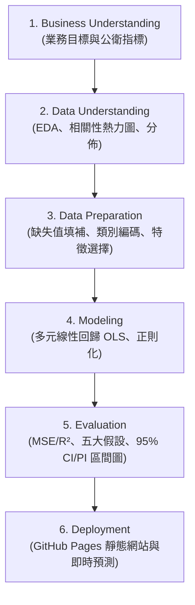

# 物聯網 HW2: 多元線性回歸分析系統 (Multiple Linear Regression)

**線上網站**：https://blueet1.github.io/AIot-HW2-MLR-web-/

**CRISP-DM (Cross-Industry Standard Process for Data Mining)** 流程，建置互動式多元線性回歸 (Multiple Linear Regression) 分析與預測系統。

---

## 作業情況

  - 選擇 Kaggle 公開資料集：[Life Expectancy (WHO)](https://www.kaggle.com/datasets/kumarrajarshi/life-expectancy-who)
  - 特徵數量：**20 個輸入特徵**（嚴格符合作業 `> 13` 個特徵的限制）。
  - 完整實作**特徵選擇 (Feature Selection)**（包含 Lasso L1 正則化、RFE 遞迴特徵消除、SelectKBest F-檢定）。
  - 模型評估：MSE、RMSE、MAE、$R^2$、Adjusted $R^2$ 與迴歸五大統計假設檢驗。
  - 成果視覺化：**預測圖附帶 95% 信賴區間 (Confidence Interval) 與 95% 預測區間 (Prediction Interval)**。
---

## CRISP-DM 分析流程



### 1. 商業與業務理解 (Business Understanding)
針對聯合國與世界衛生組織 (WHO) 收集的全球 193 國公共衛生指標，探討成人死亡率、疫苗覆蓋率、受教育年數與人均 GDP 等多元因素對國民「人均預期壽命」的邊際效應，協助各國政策制定者量化資源投放優先順序。

### 2. 資料理解 (Data Understanding)
* 樣本數：2,938 筆（涵蓋 2000 ～ 2015 年）。
* 特徵數：20 個輸入特徵，包含健康、死亡率、疫苗覆蓋率、經濟指標。
* 相關性發現：
  - **顯著正相關**：`Schooling` (0.75)、`Income composition of resources` (0.72)、`BMI` (0.57)。
  - **顯著負相關**：`Adult Mortality` (-0.70)、`HIV/AIDS` (-0.56)、`thinness` (-0.48)。

### 3. 資料前處理與特徵選擇 (Data Preparation & Feature Selection)
* 針對數值欄位以中位數填補缺失值，類別欄位 (`Status`) 進行二元虛擬變數編碼。
* 診斷發現 `infant deaths` 與 `under-five deaths`、`thinness 1-19` 與 `thinness 5-9` 存在嚴重共線性（$r > 0.9$）。
* 比較 **Lasso (L1)** 與 **RFE (遞迴特徵消除)**，成功篩選出關鍵 14~17 個獨立特徵，顯著降低 VIF。

### 4. 建模與假設檢定 (Modeling & Diagnostics)
* 使用 `statsmodels.api.OLS` 進行多元線性回歸。
* 五大迴歸統計假設檢定：
  1. **常態性 (Normality)**：繪製 Q-Q Plot 檢驗殘差分佈。
  2. **線性與同質變異 (Homoscedasticity)**：繪製 Fitted vs Residuals 殘差散佈圖。
  3. **獨立性 (Independence)**：計算 Durbin-Watson 統計量（$\approx 2.0$ 代表無自相關）。
  4. **共線性 (Multicollinearity)**：動態 VIF 診斷表。

### 5. 模型評估與區間圖 (Evaluation)
* 測試集績效：
  - **$R^2$**：約 **0.8196**（模型解釋力達 82%）
  - **RMSE**：**3.95 年**
  - **MAE**：**2.93 年**
* **預測區間圖**：透過 OLS 的協方差矩陣精確計算每一筆測試樣本的：
  - **95% 信賴區間 (Mean CI)**：估計母體期望值範圍。
  - **95% 預測區間 (Obs PI)**：涵蓋個體隨機誤差 $\epsilon$ 的單一數值預測區間。

### 6. 模型部署 (Deployment)
網站為純靜態 HTML + JavaScript，部署於 **GitHub Pages**，無需後端伺服器：
* `assets/stats.js`：以 JavaScript 實作 OLS（係數、標準誤、t/p 值、F、AIC/BIC）、95% CI / PI、VIF、SelectKBest、RFE、LassoCV、Jarque–Bera、Breusch–Pagan、Durbin–Watson。數值已與 `statsmodels` / `scikit-learn` 交叉驗證一致（係數、標準誤、CI/PI 相同至 10 位有效數字以上）。
* `assets/app.js`：CRISP-DM 七個分頁、資料集下拉選單、自訂 URL / 上傳、Plotly 圖表與即時預測滑桿。
* 使用者可即時拉動各項特徵拉桿，系統動態給出點預測值與 CI/PI 上下限。

---

## 🤖 AI 協助與 NotebookLM 研究摘要

### 1. NotebookLM 網路解法研究摘要
> **摘要主題**：基於世界衛生組織 (WHO) 全球預期壽命資料集的多元回歸分析文獻與網路解法探討
> 
> **NotebookLM 研析內容**：
> 針對WHO全球預期壽命資料集的多元線性迴歸分析，前處理在缺失值上存在直接刪除、中位數填補或插值法之差異，並常搭配獨熱編碼與對數轉換。對嬰兒與五歲以下死亡率、收入與教育等高度相關特徵，研究多採VIF檢驗或白化處理化解共線性。特徵選擇常用Lasso、逐步迴歸與相關篩選以精簡模型。模型顯示收入指數與疫苗覆蓋率呈顯著正相關（係數為正），成人死亡率與HIV/AIDS呈顯著負相關（係數為負）。線性模型 R² 介於0.77至0.89，RMSE為1.89至4.27歲，但常違反殘差常態性與同變異數假設。總結而言，網路解法雖證實經濟與醫療指標具預測力，但純線性模型受限於假設未滿足與非線性捕捉能力，且缺乏武裝衝突等外部結構變數。

### 2. Claude Code 輔助內容說明
* 使用 Claude Code 設計符合 CRISP-DM 規範的分析架構，並輔助撰寫特徵選擇比較演算法與假設檢定程式碼。
* 完整對話紀錄：[HW2-chat-history.pdf](docs/HW2-chat-history.pdf)（文字版：[md](docs/HW2-chat-history.md)）。

---

## 💻 本地執行指南

### 1. 安裝環境與相依套件
```bash
python3 -m venv .venv
source .venv/bin/activate
pip install -r requirements.txt
```

### 2. 執行獨立回歸分析腳本
```bash
python3 analysis.py
```
執行後將在終端機輸出各階段評估指標，並在 `output/prediction_interval_plot.png` 生成高解析度預測區間圖。

### 3. 本機預覽網站
網站需透過 HTTP 伺服器開啟（直接雙擊 `index.html` 會因 `file://` 無法讀取 CSV）：
```bash
python3 -m http.server 8000
```
開啟 `http://localhost:8000` 即可。

### 4. 部署到 GitHub Pages
```bash
git init && git add . && git commit -m "HW2 multiple linear regression"
git branch -M main
git remote add origin https://github.com/<帳號>/<repo>.git
git push -u origin main
```
到 GitHub repo → **Settings → Pages → Build and deployment**，Source 選 **Deploy from a branch**，Branch 選 `main` / `/ (root)`，儲存後約 1 分鐘即可於 `https://<帳號>.github.io/<repo>/` 瀏覽。

